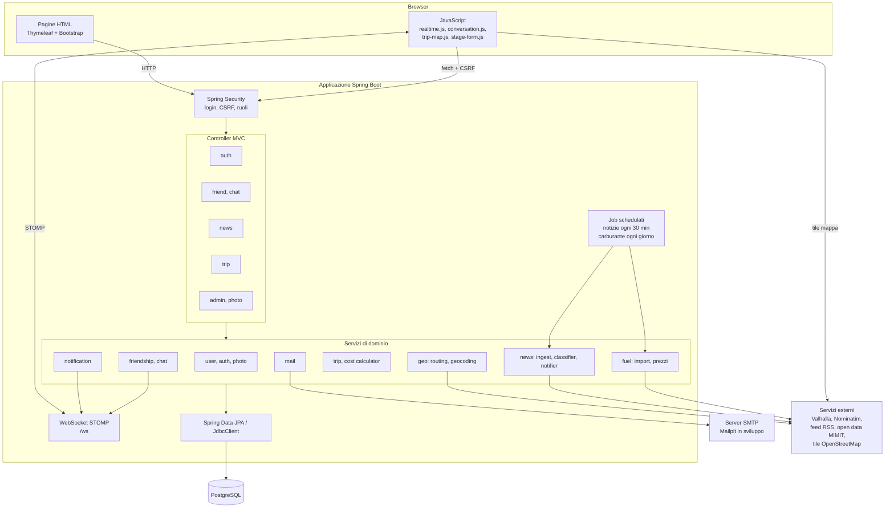
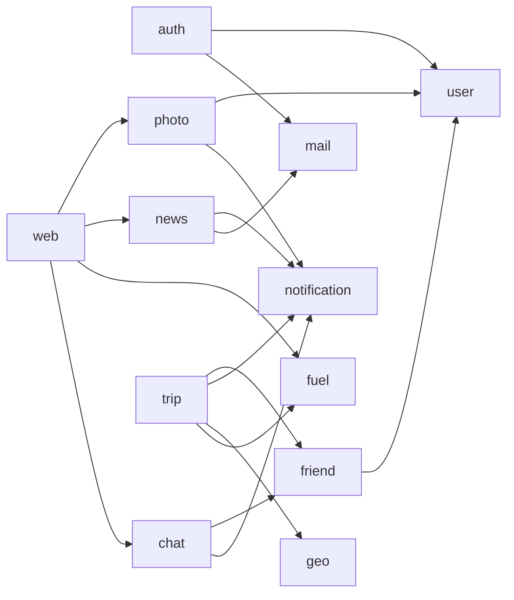
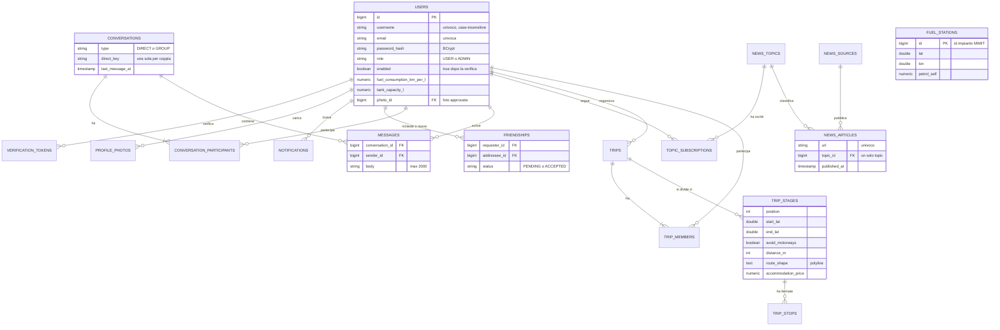

# Architettura

Documentazione tecnica di MotoRide: com'è fatta l'applicazione, quali componenti la compongono e come
collaborano. Per l'ambiente di esecuzione vedi [infrastruttura.md](infrastruttura.md), per i flussi
principali passo per passo vedi [flussi.md](flussi.md).

## Panoramica

MotoRide è un'applicazione web **monolitica modulare** scritta con Spring Boot. Il server genera le pagine
HTML (Thymeleaf); il JavaScript nel browser si limita a migliorare l'esperienza (aggiornamenti in tempo
reale, mappe, ricerca istantanea) e ogni funzione principale funziona anche senza.

| Livello | Tecnologia |
|---|---|
| Linguaggio e runtime | Java 21 |
| Framework | Spring Boot 4.1 (Spring MVC, Spring Security 7, Spring Data JPA, Spring WebSocket) |
| Vista | Thymeleaf 3.1 + Bootstrap 5.3, Leaflet 1.9 per le mappe, client STOMP (`@stomp/stompjs`) |
| Persistenza | PostgreSQL 17, Hibernate 7, migrazioni Flyway |
| Messaggistica in tempo reale | STOMP su WebSocket, broker in memoria di Spring |
| Email | Spring Mail con template Thymeleaf (Mailpit in sviluppo) |
| Librerie esterne | Rome (feed RSS/Atom), jsoup (pulizia HTML) |
| Test | JUnit 5, MockMvc, Testcontainers (PostgreSQL reale), client STOMP reale |

### Principi di progetto

- **Package per funzionalità**: ogni modulo (`chat`, `news`, `trip`, ...) contiene entità, repository,
  servizi, controller e template propri. Le dipendenze tra moduli passano dai servizi, mai dai repository di altri moduli.
- **Il server è la fonte di verità**: le azioni (inviare un messaggio, accettare un'amicizia, salvare una tappa)
  sono richieste HTTP normali con CSRF e validazione. Il WebSocket serve solo a *notificare* il browser.
- **Calcoli deterministici**: costi e distanze derivano da dati reali (percorsi Valhalla, prezzi MIMIT) e da formule
  esplicite, mai da stime generate.
- **Servizi esterni isolati**: ogni integrazione (routing, geocoding, feed, prezzi) è in un componente dedicato,
  con timeout, User-Agent identificativo e comportamento di ripiego se il servizio non risponde.

## Componenti

## Moduli

| Package | Responsabilità | Elementi principali |
|---|---|---|
| `auth` | Registrazione, verifica email, login con username o email, creazione admin | `RegistrationService`, `AppUserDetailsService`, `AdminSeeder` |
| `user` | Utente, profilo, dati della moto (consumo, serbatoio) | `User`, `UserService`, `ProfileController` |
| `photo` | Foto profilo: validazione, ri-codifica, moderazione | `ImageProcessor`, `PhotoService`, `AdminPhotoController` |
| `notification` | Notifiche in-app persistite e consegnate in tempo reale | `NotificationService`, `NotificationPushListener` |
| `friend` | Ricerca utenti, richieste e lista amici | `FriendshipService`, `Friendship` |
| `chat` | Conversazioni tra amici, messaggi, non letti, ricerca | `ChatService`, `ChatPushListener` |
| `news` | Agente sui feed, classificazione, iscrizioni ai topic, email riepilogative | `NewsIngestService`, `FeedClient`, `KeywordArticleClassifier`, `NewsNotifier` |
| `trip` | Road trip, partecipanti, tappe, fermate, alloggi, costi | `TripService`, `TripCostCalculator`, `TripMapJson` |
| `geo` | Percorsi (Valhalla), ricerca luoghi (Nominatim), polyline | `RoutingService`, `GeocodingService`, `Polyline` |
| `fuel` | Import open data MIMIT, prezzi della benzina vicino a un punto | `FuelImportService`, `FuelPriceService`, `MimitCsv` |
| `mail` | Invio email HTML da template | `MailService` |
| `config` | Sicurezza, WebSocket, proprietà applicative | `SecurityConfig`, `WebSocketConfig`, `AppProperties` |
| `web` | Home, pannello admin, attributi comuni a tutte le pagine (badge navbar) | `AdminController`, `GlobalModelAdvice` |

### Dipendenze tra moduli

## Comunicazione in tempo reale

Il browser apre **una sola connessione WebSocket** (`/ws`, protocollo STOMP) per pagina e si iscrive a due
code personali:

| Destinazione | Contenuto |
|---|---|
| `/user/queue/messages` | nuovi messaggi di chat |
| `/user/queue/notifications` | notifiche in-app (foto, notizie, inviti ai viaggi) |

Le regole di autorizzazione (`WebSocketConfig`) consentono **solo** l'iscrizione a queste due code: ogni altra
iscrizione o invio di frame viene rifiutato e la connessione chiusa. Gli identificativi di sessione di Tomcat sono
prevedibili, quindi senza queste regole un client potrebbe iscriversi alla coda grezza di un altro utente.
Anche il `CONNECT` STOMP richiede il token CSRF.

I messaggi vengono inviati al broker **solo dopo il commit** della transazione (`@TransactionalEventListener`):
il browser non riceve mai dati che il database potrebbe ancora annullare.

## Sicurezza

| Aspetto | Soluzione |
|---|---|
| Autenticazione | Form login Spring Security, password con BCrypt, account attivo solo dopo verifica email |
| CSRF | Attivo su tutti i form, sulle chiamate `fetch` (header) e sul `CONNECT` STOMP |
| Autorizzazione | `/admin/**` solo `ROLE_ADMIN`; controlli di appartenenza nei servizi (chat, viaggi). Le risorse altrui rispondono 404, così non se ne rivela l'esistenza |
| XSS | Escape automatico di Thymeleaf; nel JavaScript i testi si inseriscono con `textContent` |
| Upload | Immagini decodificate, ridimensionate e ri-codificate in JPEG: niente EXIF/GPS né file malevoli. Limite di dimensione e di risoluzione |
| Feed esterni | Parser XML con DOCTYPE disabilitato (anti-XXE); solo URL http/https; HTML ridotto a testo |
| Redirect | I parametri `back` accettano solo percorsi interni (anti open-redirect) |
| Segreti | Solo tramite variabili d'ambiente e file `.env` escluso da git |

## Modello dei dati

Note sul modello:

- **Unicità garantita dal database**, non solo dal codice: una sola amicizia per coppia
  (indice su `LEAST/GREATEST` degli id), una sola conversazione diretta per coppia (`direct_key`),
  una sola foto in attesa per utente (indice parziale), articoli univoci per URL.
- La tabella `conversations` prevede già il tipo `GROUP`, pensato per le chat dei partecipanti di un viaggio.
- `fuel_stations` non ha relazioni: è una copia giornaliera degli open data, interrogata per prossimità geografica.
- Le migrazioni sono in `src/main/resources/db/migration` (`V1` … `V7`). Una migrazione già applicata
  non si modifica: le correzioni vanno in una nuova versione.

## Test

| Tipo | Cosa verifica | Esempi |
|---|---|---|
| Unitari | Logica pura senza Spring | parsing feed e classificatore, CSV MIMIT, polyline, EXIF |
| Integrazione | Spring completo + PostgreSQL reale (Testcontainers); servizi esterni sostituiti da mock | autenticazione, amicizie, chat, foto, notizie, viaggi, prezzi |
| End-to-end WebSocket | Server reale su porta casuale e client STOMP reale | push dei messaggi, rifiuto senza CSRF, iscrizioni vietate |

Tutti i test di integrazione estendono `IntegrationTest` e condividono un unico contesto Spring.
