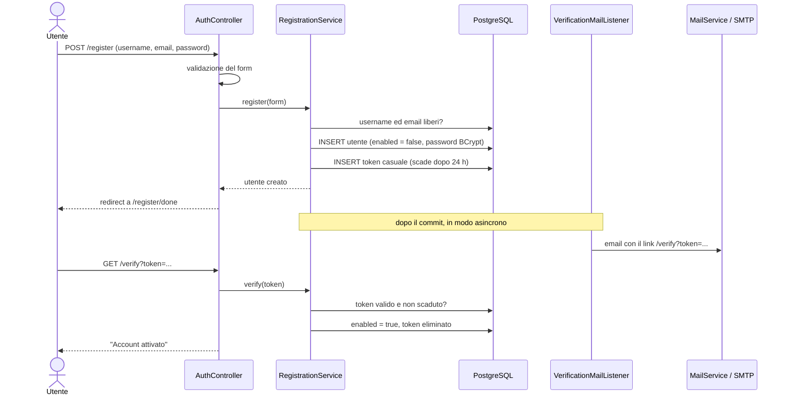
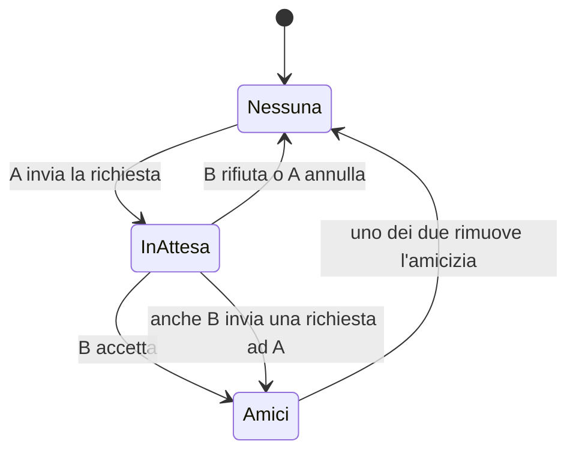
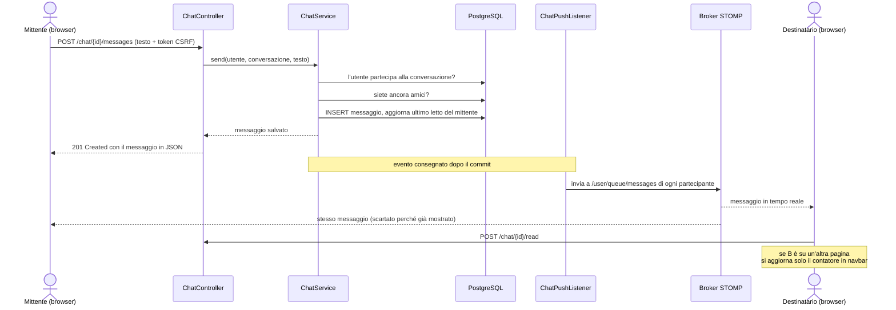
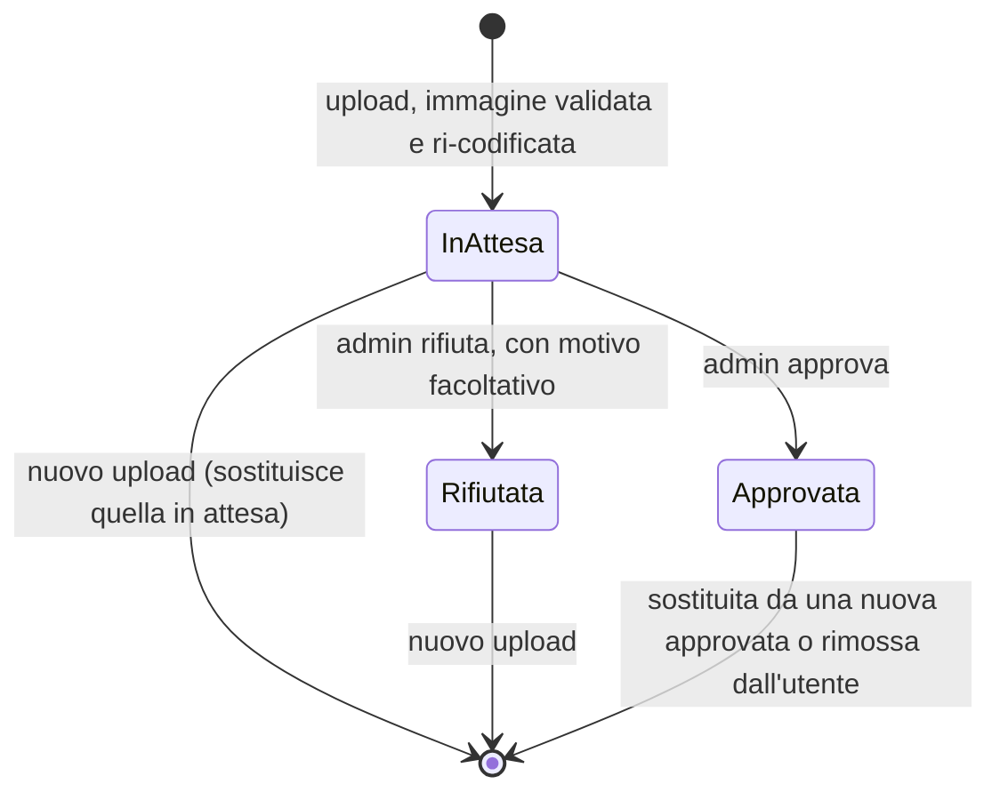
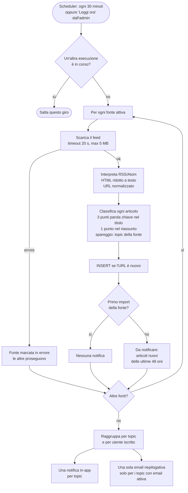
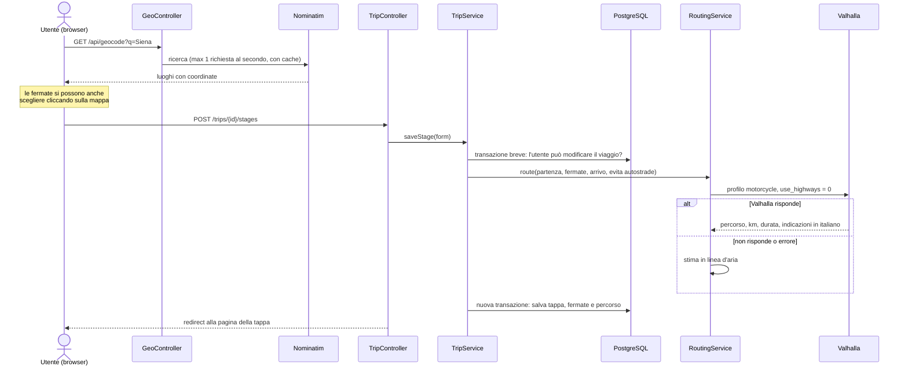
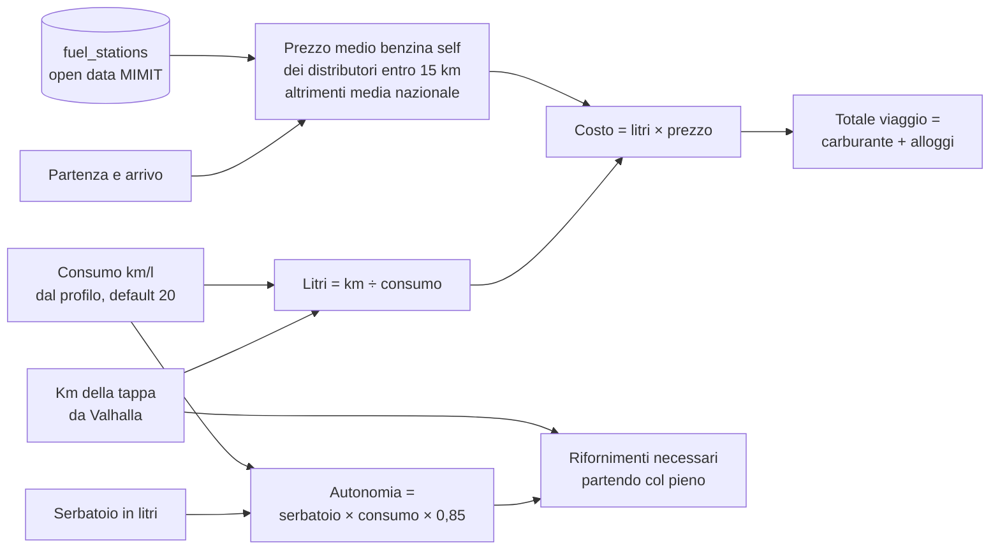
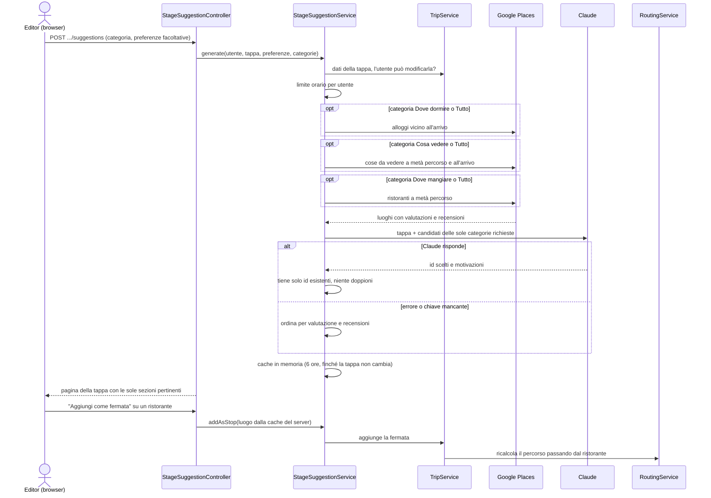
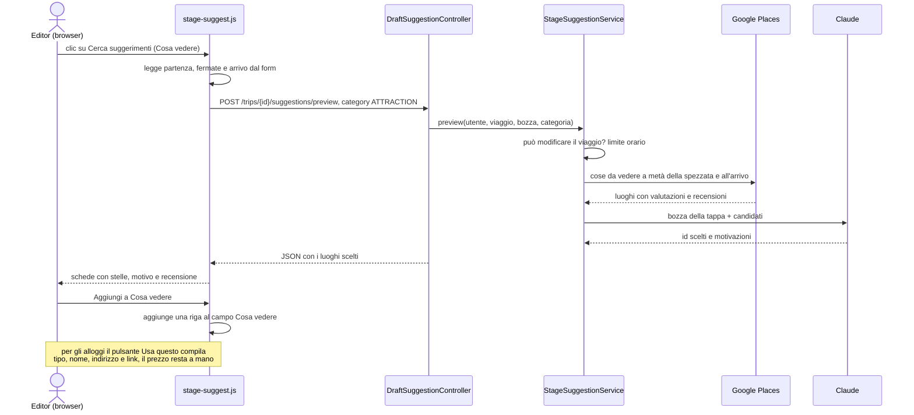

# Flussi principali

Come collaborano i componenti nelle operazioni più importanti. Per la struttura generale vedi
[architettura.md](architettura.md).

## 1. Registrazione e verifica dell'email

L'account resta disattivato finché l'utente non apre il link ricevuto via email. L'email parte solo dopo
il commit della transazione e in un thread separato, quindi la registrazione non attende il server SMTP.

## 2. Amicizia

Rifiuto, annullamento e rimozione cancellano la riga, così in seguito si può inviare una nuova richiesta.
Un indice univoco sulla coppia di utenti impedisce richieste doppie, anche contemporanee.

## 3. Messaggio in chat

Il messaggio si invia con una normale richiesta HTTP. Il WebSocket serve solo a consegnarlo agli altri
browser, dopo che il database l'ha salvato definitivamente.

## 4. Foto profilo

- Durante l'attesa la foto è visibile solo al proprietario e agli admin; quella approvata in precedenza resta in uso.
- Approvazione e rifiuto generano una notifica all'utente, consegnata in tempo reale.
- Il file originale non viene mai salvato: si conserva solo il JPEG 400×400 prodotto dal server.

## 5. Agente notizie

## 6. Pianificazione di una tappa

Il calcolo del percorso è una chiamata esterna che può durare decine di secondi, quindi avviene **fuori**
dalla transazione: il database resta impegnato solo per i controlli e il salvataggio.

La ricerca dei luoghi mette **città e luoghi veri prima delle aree amministrative**. Cercando "Siena",
Nominatim restituisce per prima la *provincia*, le cui coordinate sono un punto interno a circa 25 km dalla città.
Un arrivo salvato lì sposterebbe anche costi e consigli AI.

Dalla pagina della tappa il pulsante **Apri in Google Maps** apre l'app o il sito di Google Maps con partenza,
fermate e arrivo già impostati (Maps URLs, senza chiave API). Google Maps accetta al massimo 9 punti intermedi
(3 da smartphone) e non riceve l'opzione "evita autostrade": la pagina lo segnala.

### Calcolo dei costi (alla visualizzazione)

I costi non vengono salvati: si calcolano ogni volta per **chi sta guardando**, con il consumo della sua
moto e i prezzi aggiornati all'ultimo import.

## 7. Consigli AI per una tappa

Solo con la modalità AI accesa. Google fornisce i luoghi reali, Claude sceglie e motiva, il server controlla.
L'utente sceglie cosa cercare: **Tutto**, **Dove dormire**, **Cosa vedere** o **Dove mangiare**; si interrogano
solo le categorie richieste.

Il browser invia solo l'id del luogo: nome e coordinate della fermata vengono dalla cache del server,
non da dati del client.

### Suggerimenti dal form della tappa

Nel form, accanto a *Cosa vedere* e ad *Alloggio a fine tappa*, il pulsante **Cerca suggerimenti** funziona anche
prima di salvare la tappa: usa le coordinate già inserite e compila il form con il luogo scelto.

## 8. Permessi in un road trip

| Azione | Organizzatore | Editor | Sola lettura | Non partecipante |
|---|:---:|:---:|:---:|:---:|
| Vedere viaggio e tappe | ✔ | ✔ | ✔ | 404 |
| Aggiungere, modificare, riordinare tappe | ✔ | ✔ | 403 | 404 |
| Modificare o eliminare il viaggio | ✔ | 403 | 403 | 404 |
| Invitare amici e cambiare ruoli | ✔ | 403 | 403 | 404 |
| Generare consigli AI e usarli | ✔ | ✔ | 403 (vede quelli già generati) | 404 |
| Lasciare il viaggio | — | ✔ | ✔ | — |

Si possono invitare solo i propri amici; l'invitato riceve una notifica in tempo reale.
