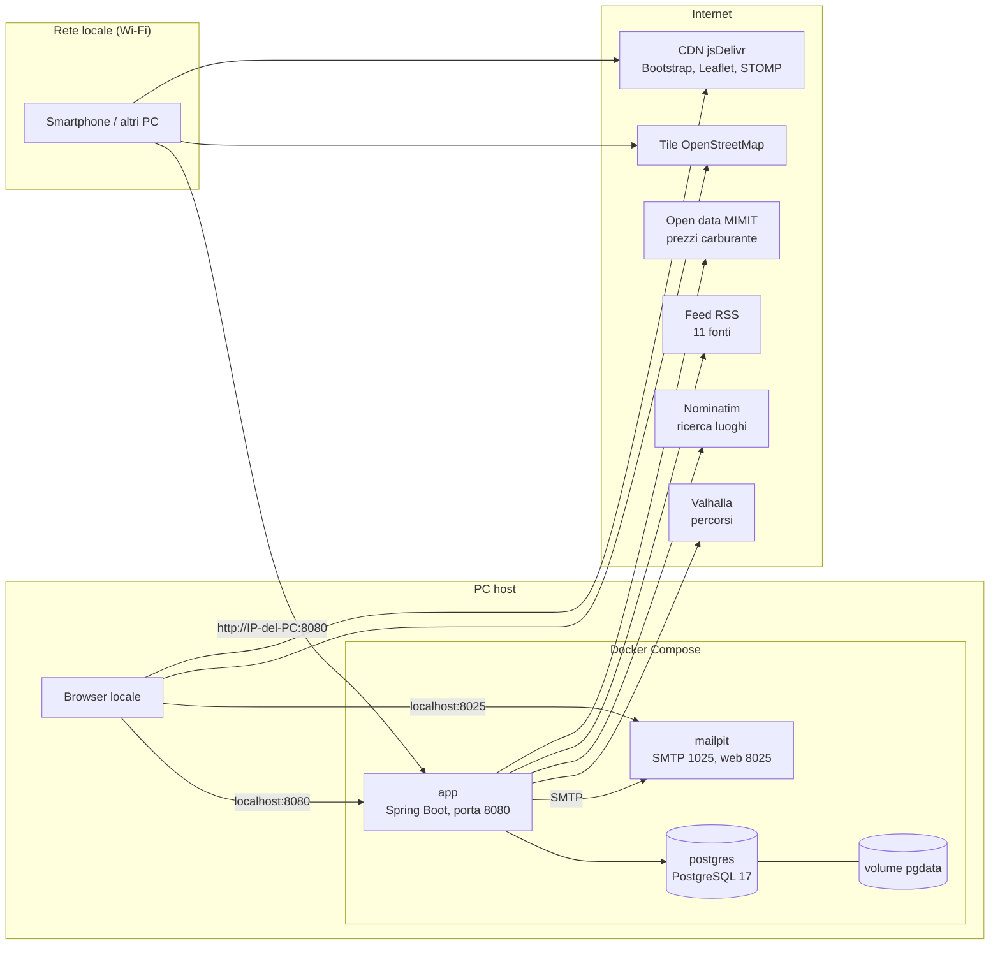

# Infrastruttura

Come e dove gira MotoRide, quali servizi usa e come si configura. Per la struttura del codice vedi
[architettura.md](architettura.md).

## Ambiente con Docker Compose



| Servizio | Immagine | Porta sul PC | Raggiungibile da | Note |
|---|---|---|---|---|
| `app` | costruita dal `Dockerfile` | `APP_PORT` (default 8080) | tutta la rete locale | profilo Compose `app` |
| `postgres` | `postgres:17-alpine` | 5433 | solo il PC (`127.0.0.1`) | dati nel volume `pgdata` |
| `mailpit` | `axllent/mailpit` | 1025 SMTP, 8025 web | solo il PC (`127.0.0.1`) | raccoglie le email in sviluppo |

Il database e la casella di posta di sviluppo non sono esposti alla rete: solo l'applicazione lo è.

### Immagine dell'applicazione

Il `Dockerfile` è multi-stage:

1. **build** (`maven:3.9.9-eclipse-temurin-21`): scarica le dipendenze (in cache finché non cambia il `pom.xml`)
   e produce il jar senza eseguire i test.
2. **runtime** (`eclipse-temurin:21-jre`): solo JRE e jar, eseguito da un utente non privilegiato,
   memoria della JVM proporzionata al container (`MaxRAMPercentage=75`).

### Comandi

```powershell
docker compose --profile app up -d --build    # avvia o aggiorna tutto
docker compose logs -f app                    # log dell'applicazione
docker compose --profile app down             # ferma tutto (i dati restano)
```

Senza `--profile app` vengono avviati solo PostgreSQL e Mailpit: è la modalità usata da
`mvn spring-boot:run` durante lo sviluppo (Spring Boot avvia da solo il Compose).

## Accesso dagli altri dispositivi della rete

L'applicazione è in ascolto su tutte le interfacce del PC. Per usarla da smartphone o altri computer
connessi allo stesso Wi-Fi:

1. Trova l'indirizzo IP del PC (`ipconfig` su Windows, voce *Indirizzo IPv4* della scheda Wi-Fi).
2. Nel file `.env` imposta `APP_BASE_URL=http://<IP-del-PC>:8080`, così anche i link nelle email
   portano all'indirizzo corretto, poi riavvia con `docker compose --profile app up -d`.
3. Dal dispositivo apri `http://<IP-del-PC>:8080`.

Se non risponde:

- **Firewall di Windows**: Docker Desktop crea una regola "Docker Desktop Backend" che consente le connessioni
  in entrata sui profili *Dominio* e *Pubblico*. Se la rete è classificata come *Privata* serve una regola
  aggiuntiva per la porta (da PowerShell come amministratore):
  `New-NetFirewallRule -DisplayName "MotoRide 8080" -Direction Inbound -Protocol TCP -LocalPort 8080 -Action Allow -Profile Private`
- **Isolamento dei client** del router (tipico delle reti ospiti): impedisce ai dispositivi di vedersi tra loro.
- **IP cambiato**: con DHCP l'indirizzo del PC può cambiare; conviene riservarlo nel router.

> L'accesso dalla rete locale usa HTTP in chiaro: va bene per una rete domestica fidata, non per reti pubbliche.
> Per un'esposizione su Internet serve un reverse proxy con HTTPS (vedi più sotto).

## Configurazione

Tutta la configurazione arriva da variabili d'ambiente, con valori di default adatti allo sviluppo
(`src/main/resources/application.yml`). Con Docker Compose i valori personali vanno nel file **`.env`**,
escluso da git; il repository contiene solo `.env.example`.

| Variabile | Default | Uso |
|---|---|---|
| `ADMIN_PASSWORD` | vuota | Se valorizzata, crea l'utente `admin` al primo avvio |
| `APP_PORT` | `8080` | Porta pubblicata sul PC |
| `APP_BASE_URL` | `http://localhost:8080` | Indirizzo usato nei link delle email |
| `DB_URL`, `DB_USER`, `DB_PASSWORD` | database di Compose | Connessione PostgreSQL |
| `MAIL_HOST`, `MAIL_PORT`, `MAIL_USER`, `MAIL_PASSWORD` | Mailpit | Server SMTP |
| `MAIL_FROM` | `MotoRide <noreply@motoride.local>` | Mittente delle email |
| `APP_USER_AGENT` | `MotoRideBot/0.1` | User-Agent verso i servizi esterni |
| `NEWS_FETCH_ENABLED`, `NEWS_FETCH_INTERVAL` | `true`, `PT30M` | Agente notizie |
| `FUEL_IMPORT_ENABLED` | `true` | Import giornaliero dei prezzi carburante |
| `VALHALLA_URL` | istanza pubblica FOSSGIS | Servizio di routing |
| `NOMINATIM_URL` | istanza pubblica OpenStreetMap | Ricerca luoghi |

## Processi in background

| Processo | Quando | Cosa fa |
|---|---|---|
| Agente notizie | 20 s dopo l'avvio, poi ogni 30 minuti | Legge i feed, salva gli articoli nuovi, invia notifiche ed email riepilogative |
| Import carburante | Ogni giorno alle 9:30 (ora italiana) e al primo avvio se la tabella è vuota | Scarica anagrafica e prezzi MIMIT (circa 24.000 distributori) |
| Email | Su evento, in un thread separato | Verifica account; i riepiloghi delle notizie partono dal job dell'agente |

Entrambi i job si possono avviare anche manualmente dal pannello `/admin`. Un flag impedisce due esecuzioni
contemporanee nella stessa istanza.

## Servizi esterni

| Servizio | Uso | Ripiego se non risponde |
|---|---|---|
| **Valhalla** (profilo `motorcycle`) | Percorso, distanza, durata, autostrade/pedaggi, indicazioni in italiano | Stima in linea d'aria × 1,3 a 60 km/h, segnalata in pagina con il pulsante "Riprova" |
| **Nominatim** | Ricerca dei luoghi nel form delle tappe, tramite il proxy `/api/geocode` | Si può scegliere il punto cliccando sulla mappa |
| **Feed RSS/Atom** | Notizie | La fonte viene marcata in errore, le altre proseguono |
| **Open data MIMIT** | Prezzi della benzina self e servito per distributore | Restano i prezzi dell'ultimo import riuscito |
| **Tile OpenStreetMap** | Sfondo delle mappe (caricato dal browser) | — |

Le istanze pubbliche di Valhalla, Nominatim e delle tile OpenStreetMap sono pensate per un **uso moderato**.
L'applicazione rispetta le loro policy (User-Agent identificativo, massimo una ricerca al secondo verso
Nominatim, cache dei risultati), ma con traffico reale servono istanze proprie o un fornitore commerciale:
basta cambiare gli URL nella configurazione.

## Verso la produzione

| Tema | Cosa serve |
|---|---|
| HTTPS | Reverse proxy (es. Caddy o Nginx) con certificato; `APP_BASE_URL` in https |
| Email reali | SMTP di un provider transazionale al posto di Mailpit; SPF/DKIM sul dominio |
| Più istanze dell'app | Broker STOMP esterno (es. RabbitMQ) al posto di quello in memoria; lock distribuito (es. ShedLock) per i job schedulati |
| Servizi geografici | Istanze proprie o a pagamento di Valhalla, Nominatim e tile |
| Backup | Dump periodici di PostgreSQL (il volume `pgdata` contiene tutti i dati, foto comprese) |
| Segreti | Variabili d'ambiente o secret manager; mai valori predefiniti per le password |
